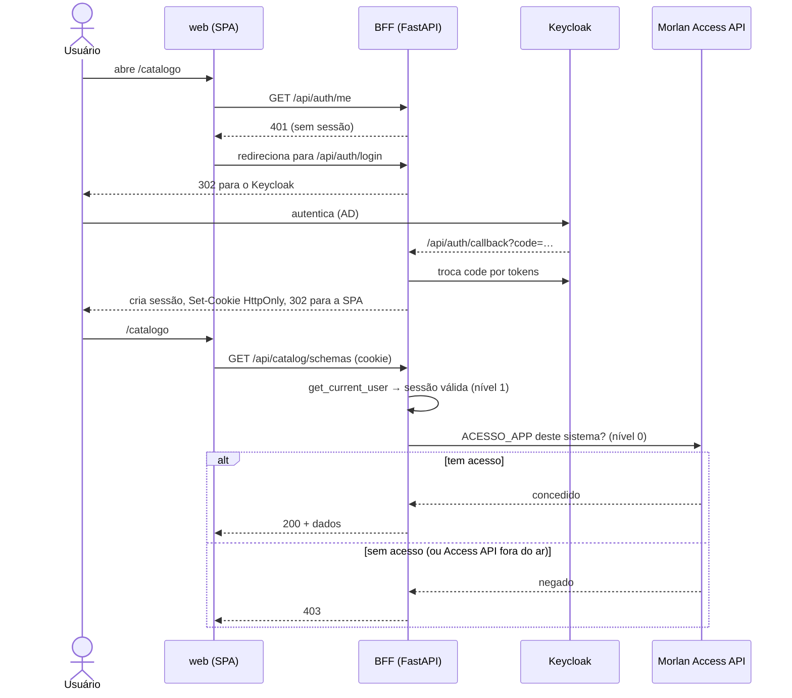
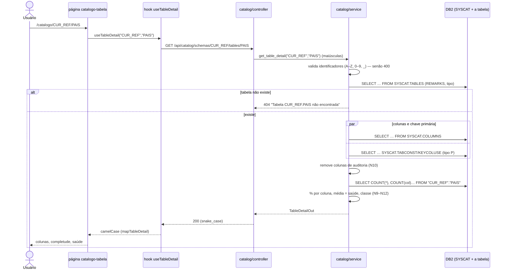
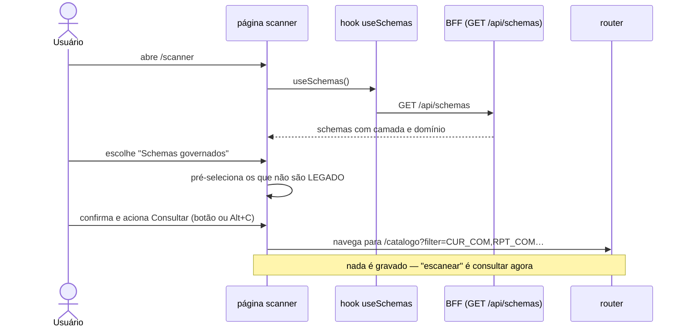

# Catálogo de Dados — diagramas de sequência

Um diagrama por fluxo de negócio relevante (não por rota). Caminho completo:
usuário → tela → hook → BFF (controller → service) → DB2 → volta. Formato Mermaid.

> **DER:** não se aplica — o app não tem tabela própria (o schema `cur_gov` só é criado; o
> catálogo é lido ao vivo do DB2). `cur_tin.log_exec_web` (log) e a sessão são infraestrutura
> compartilhada, fora do modelo deste app.

## 1. Entrar na aplicação (SSO + gate de acesso)



## 2. Abrir o detalhe de uma tabela (saúde dos dados)



## 3. Dashboard — saúde dos schemas legados (amostragem)

```mermaid
sequenceDiagram
    actor U as Usuário
    participant P as página dashboard
    participant C as dashboard/controller
    participant S as dashboard/service
    participant D as DB2

    U->>P: abre o Dashboard
    P->>C: GET /api/dashboard/saude-legado
    C->>S: get_saude_legado()
    S->>D: lista de schemas (SYSCAT.TABLES agrupado)
    S->>S: separa os de camada LEGADO
    loop cada schema legado (até 8 em paralelo)
        S->>D: SELECT TABNAME … ORDER BY CARD ASC, FETCH FIRST 20
        loop candidatas, até completar 5
            S->>D: colunas + COUNT(col) da tabela (limite de 5 s)
            alt falhou (sem permissão ou lenta)
                S->>S: descarta e tenta a próxima
            else ok
                S->>S: adiciona à amostra do schema
            end
        end
    end
    S->>S: média por schema e geral; schemas sem amostra → "sem acesso" (N15)
    S-->>P: SaudeLegadoOut
    P-->>U: gráfico de colunas por schema
```

## 4. Scanner — escolher schemas e consultar


